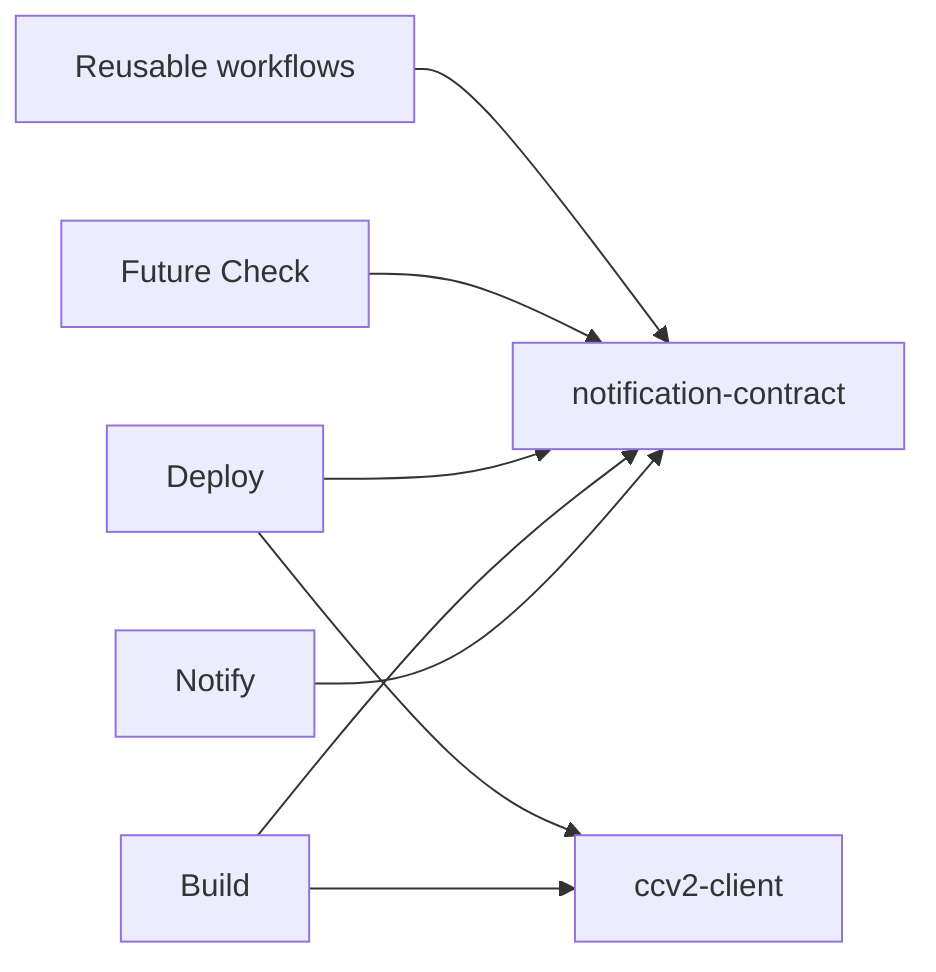

# CommerceKit Action Kit

Shared contracts and runtime libraries for CommerceKit GitHub Actions. This public repository is a pnpm monorepo, not a GitHub Marketplace Action. There is no root `action.yml`.

The current integration release is `0.0.2` for both packages, distributed under the `preview` dist-tag. APIs remain pre-1.0; verify registry publication before installation. Placeholder reserved versions, if published later, are not supported dependencies.

| Package                                    | Responsibility                                                                                | Consumers                                                                      |
| ------------------------------------------ | --------------------------------------------------------------------------------------------- | ------------------------------------------------------------------------------ |
| `@commercekit-tools/notification-contract` | NotificationEvent v1 schema, semantic validation, safe context, factories and text primitives | Notify, Build, Deploy, future Check, reusable workflows and external producers |
| `@commercekit-tools/ccv2-client`           | Technical-user OAuth and policy-driven Cloud Portal HTTP transport                            | Build, Deploy and future CCv2 Actions                                          |

The packages release independently and do not depend on each other. Notification producers need no CCv2 knowledge. Neither package depends on GitHub Actions SDKs.



Provider rendering and delivery, Action inputs/outputs, summaries, lifecycle state machines and endpoint-specific validation remain in consumers. See [architecture](docs/architecture.md) and [extraction audit](docs/extraction-audit.md).

Installation requires GitHub Packages access, including for public packages. Configure the scope registry and credentials using [the authentication guide](docs/github-packages.md). Consumers must pin exact supported versions. The source manifests contain intended first preview versions; this is not evidence of publication.

Develop with Node **24.21.0** and pnpm **12.6.0**:

```sh
corepack enable
pnpm install --frozen-lockfile
pnpm quality
```

The quality suite checks formatting, lint, TypeScript, coverage, builds, installed package tarballs, public files and dependency advisories. Tests use synthetic data and injected fetch; no SAP, Sandbox or GitHub Packages calls occur in the quality suite. Dependency installation/auditing uses the public npm registry.

See [CONTRIBUTING](CONTRIBUTING.md) for individual commands, [compatibility policy](docs/compatibility-policy.md), [migration plan](docs/migration-plan.md) and [SECURITY](SECURITY.md).

Package reservation, preview/stable publication and GitHub Releases are separate manually confirmed owner workflows. Publication never runs on push or PR. [RELEASING](RELEASING.md) describes two-phase recovery and coordinated stable gates. No package or Action is published by this implementation PR.

The manual publish workflow verifies the exact commit's CI/CodeQL results and publishes the tested tarball after an integrity check. A separate manual workflow verifies registry publication before creating a package-specific Git tag and GitHub Release. See [dispatch examples](RELEASING.md#dispatch-examples-after-merge-and-owner-approval). Tags do not trigger publication.
